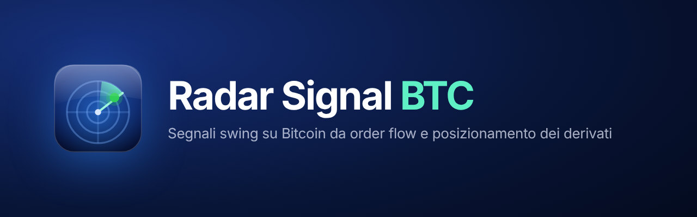
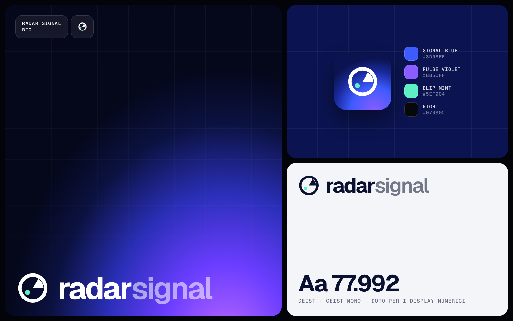

<p align="center"></p>

# Radar Signal BTC

Segnali di trading su **Bitcoin** con due strategie complementari, in uso con **capitale reale dal 02/11/2026**:

- **W2 settimanale con filtro MACD**: poche operazioni grandi (circa 2–3 l'anno, settimane o mesi ciascuna), long in spot senza leva,
  short in perp con tetto di rischio. Segue il trend settimanale e, nei rialzi già vecchi, rientra solo se il MACD settimanale conferma.
- **v2 giornaliera**: swing brevi (circa 22 trade l'anno, pochi giorni ciascuno) da order flow e posizionamento dei derivati, con
  conferma a 4 ore, ingresso in due tranche, stop e target precisi, leva massima 5x.

| Dal 01/01/2021 (10.000 $ a 1x, commissioni e slippage inclusi) | W2 + MACD | v2 | Tenere BTC |
|---|---|---|---|
| 10.000 $ diventano | **122.868 $** | **27.056 $** | 26.823 $ |
| Max drawdown giornaliero | −22,7% | −11,1% | −76,6% |
| Trade / win rate | 14 · 93% | ~105 · 79% | – |

Le due strategie si muovono quasi in modo indipendente (correlazione circa 0,1): insieme il drawdown si riduce. Tutto arriva su
**Telegram** con il piano in dollari sul capitale impostato; la **dashboard** si aggiorna da sola ogni ora con GitHub Actions.
Come operare: [Operatività reale](#operatività-reale-dal-02112026-due-strategie). Storia della ricerca e lezioni: `RESEARCH.md`.

**Dashboard:** https://andreagalanti91.github.io/radar/ · **Bot:** [@CryptoRadarGalaBot](https://t.me/CryptoRadarGalaBot)

## Operatività reale (dal 02/11/2026): due strategie

Si usano **solo due strategie**, scelte perché sono le migliori e si muovono in modo quasi indipendente (correlazione circa 0,1):

| Dal 01/01/2021, 10.000 $ a 1x | Quota del capitale | Trade/anno | Win rate | 10.000 $ → | DD giornaliero |
|---|---|---|---|---|---|
| **W2 settimanale con filtro MACD** (spot, long; short perp con tetto) | 60% | 2,4 | 93% | 122.868 $ | −22,7% |
| **v2 giornaliera** (perp, rischio 4,3% per trade, leva max 5x) | 40% | ~22 | 79% | 27.056 $ | −11,1% |

Impostazioni (GitHub → Settings → Secrets and variables → Actions → **Variables**): `RADAR_CAPITAL` = capitale reale totale in
dollari, `RADAR_WEEKLY_SHARE` (predefinito 0,6) e `RADAR_DAILY_SHARE` (predefinito 0,4). I piani in dollari su Telegram usano queste
quote. Ogni trade reale va registrato con `/entrato`, `/limit`, `/uscito` (vedi sotto): serve a misurare slippage e aderenza al piano.
Caso peggiore storico da ricordare: un crollo come il 2018 sul settimanale (−18% con il filtro MACD, −56/−72% senza).

**Ogni settimana, in pratica:**
1. **W2** (la domenica sera decide, il lunedì si esegue): all'alert *SEGNALE SETTIMANALE* compra in spot l'importo indicato e metti
   lo stop iniziale; a ogni *trailing aggiornato* sposta lo stop; all'*USCITA SETTIMANALE* vendi all'apertura del lunedì.
2. **v2** (qualsiasi giorno): all'alert di *conferma* apri il 40% a mercato e il limit del 60%, con stop e take profit del piano;
   chiudi al take profit, allo stop o dopo 14 giorni come indicato.
3. **Registro**: dopo ogni operazione `/entrato`, `/limit` o `/uscito` su Telegram. Il lunedì alle 08:41 arriva il resoconto della
   settimana con il confronto fra trade reali e segnali.

## La dashboard

Pensata per il telefono (si installa come app dalla schermata Home), dark-first con tema chiaro. Il prezzo è **live** (Binance in tempo reale, Coinbase come riserva); dati, notizie e dashboard si aggiornano ogni ora. Sezioni:

| Sezione | Cosa trovi |
|---|---|
| **Oggi** | prezzo live, regione prevista a 7 giorni, score di flusso, **stato v2** (nessun segnale / in attesa di conferma 4h con soglia e scadenza / ingresso confermato / trade aperto) con piano, rischio, leva e **calcolatore in dollari sul tuo capitale**, **stato del settimanale W2** (posizione, trailing, EMA 21, distribuzione, **filtro MACD**: nuovi long consentiti o bloccati), stato dei 6 setup, conti **su carta** (H2 e v2), grafico con i trade |
| **Simulatore** | capitale, data di partenza e size (1x = piano v2, 2x, 3x, 5x): quanto varrebbe oggi seguendo i segnali v2; quante volte un obiettivo di capitale è stato raggiunto in passato |
| **Statistiche** | curva di equity v2 contro BTC, esiti (TP, stop, tempo), storico trade per trade (segnale, conferma, limit, uscita), **registro dei segnali reali** dal 31/10/2026, risultati per periodo e per anno, 10.000 $ a 1x/2x/5x, per setup, **storico del settimanale W2** (trade, anni, 10.000 $ a 1x/2x); Laboratorio con le due strategie in uso |
| **Notizie** | schede Impatto, Dati macro (con calendario economico della settimana, previsioni, dati precedenti e perché contano per BTC), Bitcoin, ETF e istituzionali, Regole, Derivati e on-chain |
| **Metodo** | regole complete e limiti del sistema |

## Regione prevista

Ogni giorno il modello stima la **regione** in cui il prezzo andrà nei prossimi 7 giorni: una **zona di acquisto** sotto il prezzo (dove piazzare ingressi DCA, spot o a leva) e una **zona di vendita** sopra (target o short). La profondità dei ritracciamenti è misurata in ATR e si usano i quantili storici nello stesso regime di trend e flusso, senza guardare al futuro (`radar/zones.py`).

Validazione 2021–2026 (1857 giorni): la zona di acquisto viene toccata entro 7 giorni nel **65%** dei casi, quella di vendita nel **64%**; comprare al centro della zona ha dato un ingresso in media **4,4%** migliore del prezzo di chiusura. Nel 39% dei casi il prezzo scende sotto la zona: lo stop resta necessario.

## Strategia v2 in parole semplici

1. **Il segnale.** Ogni notte, alla chiusura giornaliera UTC, si controllano i 6 setup qui sotto (flusso dei perp, posizionamento,
   funding, open interest). Se uno scatta, **non si entra subito**.
2. **La conferma a 4 ore.** Si aspetta che una candela a 4 ore chiuda **sopra il massimo delle due candele 4h precedenti**
   (short: sotto il minimo), entro 72 ore. Se non succede, il segnale scade. Su Telegram arriva subito la soglia e la scadenza.
3. **L'ingresso a due livelli.** Alla conferma: **40% a mercato**, **60% con un ordine limite 0,5 ATR più in basso**
   (short: più in alto), valido 7 giorni.
4. **Stop e target.** Stop a **1 ATR dall'ingresso** per tutta la posizione. Un solo **take profit a +1R** dal prezzo medio
   (R = distanza tra medio e stop). Se dopo **14 giorni** non è uscito, si chiude.
5. **Quanto rischiare.** Si parte da un rischio base del **4,3% del capitale** per trade (variabile `RADAR_RISK`).
   Si guarda il **delta taker** della candela 4h di conferma (acquisti aggressivi meno vendite aggressive, media spot e perp):
   più è forte nella direzione del trade, più si rischia, da 0,5× a 2× il rischio base. I long con il prezzo settimanale sotto la
   media a 40 settimane rischiano il 40% in meno. Rischio per trade quindi tra **1,4% e 9,3%**.
6. **La leva** viene di conseguenza: leva = rischio / distanza dello stop, **al massimo 5x**, margine isolato (media storica 1,6x).

Una sola posizione alla volta. Il rischio di ogni trade reale si fissa alla conferma e non cambia più.

### I 6 setup (il segnale giornaliero)

| Setup | Lato | Condizione | Logica |
|---|---|---|---|
| `flow` | long | z(CVD perp 14g) − z(long/short retail) > 1,5 | acquisti aggressivi sui perp + retail scettico |
| `capit` | long | drawdown 30g < −12% e open interest −8% in 7g | flush della leva: le liquidazioni hanno ripulito il mercato |
| `fundneg` | long | funding medio 7g < 0 | short affollati che pagano: carburante per uno squeeze |
| `brk` | long | nuovo massimo 20g, CVD perp > +1σ, trend rialzista | breakout confermato dal flusso |
| `sflow` | short | score < −1,5 in regime ribassista | flusso debole + retail long |
| `sfund` | short | funding 7g > +1σ in regime ribassista | rimbalzo a leva dentro un trend ribassista |

Regime ribassista: prezzo sotto la SMA200 e SMA50 sotto la SMA200. Gli short si fanno solo sui futures.

## Risultati v2 (mar 2022 – ott 2026, candele 4h, commissioni, funding e slippage 0,1% inclusi)

Rischio base dal vivo 4,3% (scelto il 31/10: è il massimo che tiene P(DD>20%) ≤ 15% con dati dal 2021 e slippage 0,2%). Drawdown sull'equity **giornaliera** (non solo trade per trade).

| | 2022–23 (scelta dei parametri) | 2024–25 (verifica) | 2026 (verifica) | **Totale** |
|---|---|---|---|---|
| Trade | 49 | 38 | 18 | **105** |
| Win rate | 77,6% | 78,9% | 83,3% | **79,0%** |
| Rendimento | +27,7% | +52,6% | +38,8% | **+170,5%** |
| Max drawdown giornaliero | −10,6% | −11,1% | −3,6% | **−11,1%** |
| Aspettativa per trade | +0,53% | +1,16% | +1,87% | +0,99% |

Per anno: 2022 +14,2% · 2023 +11,8% · 2024 +9,7% · 2025 +39,2% · 2026 +38,8%.
Win rate sopra +1% sul capitale 63,8%, profit factor 2,43, durata media 3 giorni, leva media 1,4x.

**Walk-forward** (ricerca, notte 01:47): la fonte del delta taker scelta solo sul passato è la stessa in entrambe le finestre e resta
positiva fuori campione: 2024–25 +63,2% (DD −13,4%) contro H2 senza size +37,2%; 2026 +45,9% (DD −4,2%) contro +22,7%.

| 10.000 $ (size del piano v2, esposizione massima 5x) | 1x | 2x | 5x |
|---|---|---|---|
| Capitale finale | **27.056 $** | 55.053 $ | 121.995 $ |
| Max drawdown (giornaliero a 1x, per trade a 2x/5x) | −11,1% | −20,7% | −39,8% |
| Peggior trade | −5,6% | −11,2% | −21,3% |

2x e 5x moltiplicano la size di ogni trade con il tetto di esposizione a 5x del conto (5x solo come confronto: drawdown oltre il 40%).
Registro dei trade in stop con l'analisi di ciascuno: [research/LOSERS.md](research/LOSERS.md).

**Confronto con la strategia precedente** (segnale giornaliero, DCA a 3 tranche, stop 3 ATR, uscite a scaglioni, 49 trade):
+34,9% a 1x con drawdown giornaliero −28,1%. v2: **+170,5% con −11,1%**.

**Con slippage 0,2%** al rischio 4,67% (precedente valore dal vivo): +140,3%, DD −12,8%, WR 76,9%. Dal 2021 con slippage 0,2% il
rischio massimo che tiene la coda è 4,3%: è il valore scelto per il tool.
Al rischio di ricerca 5,24% e slippage 0,1%: +225,8%, DD −13,5%, 10.000 $ → 32.580 $.

### Limiti (onesti)
- **Bootstrap al limite**: al rischio di ricerca la probabilità di un drawdown oltre il 20% nei ricampionamenti è 15,0%, esattamente
  la soglia del criterio. Per questo il rischio dal vivo è più basso (4,67%). Alcuni vicini dei parametri (k 2,0, clip 0,12, W 0,7) la sforano.
- **Dipende dal delta della barra di conferma**: con il delta della barra precedente il vantaggio sparisce (2026 da +48,6% a +11,8%).
  Non è un errore di look-ahead (la barra è chiusa prima dell'ingresso), ma il dato va letto subito.
- **Latenza del perp**: l'archivio dei perp arriva con circa 1 giorno di ritardo; dal vivo il delta è spesso solo spot (regola prudente,
  nella ricerca spot da solo rende meno del mix: +206% contro +226%).
- **~1 ora di ritardo**: il controllo è orario, quindi l'ingresso reale avviene fino a circa un'ora dopo la chiusura 4h di conferma
  (in simulazione: all'apertura della barra successiva). Anche i dati giornalieri dei derivati possono arrivare in ritardo.
- 105 trade in sequenza: un trade spostato cambia il risultato di alcuni punti. Il registro reale parte dal 31/10/2026.
- Con stop vicino e target unico le perdite medie (−3,6% sul capitale) valgono circa una vincita e mezza (+2,3%).

La strategia giornaliera precedente resta nel codice (`radar/backtest.py`, `radar/research.py`) come banco di ricerca.

## Segnale settimanale (W2)

Secondo segnale reale, accanto a v2 (che non cambia). Per chi preferisce **poche operazioni grandi** a tante piccole.
Si guarda solo la **candela settimanale** (da lunedì a domenica, chiusura UTC della domenica); si entra o si esce all'apertura del lunedì.

1. **Il trend.** Long solo se la settimana chiude **sopra la media a 40 settimane** e la EMA 20 settimanale sale. Short solo in
   trend ribassista: chiusura sotto la media a 40 settimane, media a 40 in calo su 4 settimane, EMA 20 in calo.
2. **L'ingresso.** La settimana chiude dal lato giusto della **EMA 21 settimanale** e il flusso dei perp (CVD perp 14 giorni) va
   nella stessa direzione. **Filtro MACD (dal 02/11/2026):** nei trend vecchi (sopra la media a 40 settimane da almeno 16
   settimane) un nuovo long entra solo se il **MACD settimanale 8/21/5** è sopra la linea di segnale e sopra zero: evita i
   rientri sul ritest del top che fallisce (2021-05, 2024-05/07/08; nel 2018 la perdita passa da −56% a −18%).
3. **Come.** Long in **spot, senza leva** (niente funding). Short in **perp**, con esposizione ridotta quando lo stop è lontano:
   lo stop iniziale non costa mai più del **25% del capitale** dedicato.
4. **L'uscita**, alla prima di tre: **trailing 2,5 ATR settimanali** dalla miglior chiusura giornaliera (controllato ogni ora);
   chiusura settimanale oltre la EMA 21; **distribuzione** (long: funding medio 7 giorni sopra 0,09% al giorno con flusso perp
   negativo; short: funding sotto −0,03% con flusso positivo). Stop iniziale a 2,5 ATR settimanali.

Su Telegram: **SEGNALE SETTIMANALE** con il piano (spot o perp, esposizione, importi, stop, uscite), **trailing aggiornato** quando
si sposta di oltre 1 ATR giornaliero, **allerta distribuzione**, **USCITA SETTIMANALE** con motivo e risultato, allerta in tempo
reale se il trailing viene toccato. Importi su `RADAR_CAPITAL` × `RADAR_WEEKLY_SHARE` (predefinito 1,0 = tutto il capitale:
**decidi tu** quanta parte dedicare al settimanale, ad esempio 0,5 per metà).

| Dal 01/01/2021 al 30/10/2026 (commissioni, funding e slippage 0,1%) | W2 |
|---|---|
| Trade | 14 (2,4 l'anno) |
| Win rate | 93% |
| Guadagno medio per trade | +21,2% sul capitale |
| Peggior trade chiuso | +1,0% (la posizione aperta è a −0,8%) |
| Rendimento | **+1.128,7%** (10.000 $ → 122.868 $; a 2x 660.713 $) |
| Max drawdown giornaliero | **−22,7%** (a 2x −37,3%) |
| MAR (rendimento / DD) | 49,8 |

Per anno: 2021 +188,1% · 2022 +19,4% · 2023 +47,1% · 2024 +108,6% · 2025 +1,9% · 2026 +14,2%.
Senza il filtro MACD (W2 fino al 01/11/2026): 19 trade, +617,6%, DD −42,6%. **Attenzione:** il filtro è nato guardando i perdenti
del 2021–24; regge su tutte le 54 combinazioni MACD provate e migliora anche il 2017–20 mai visto, ma ritarda di una settimana alcuni
rientri vincenti (2024-02: +61% → +42%). Il registro dei trade reali dirà se il vantaggio è vero.
Posizione al 30/10/2026: long in spot dal 24/08/2026 a 77.812 $.

**Rischio, detto chiaramente.** Il drawdown storico è **−42,6%** e nei ricampionamenti la probabilità di un drawdown oltre il 40% è
di circa **il 50%**: è un rischio da accettare consapevolmente. Prima del 2021 uno short (16/03/2020) senza tetto avrebbe perso
circa **−45%** in un solo trade; con il tetto sugli short la stessa operazione perde circa −18%. Il tetto è stato scelto **dopo** aver
visto i risultati (non era tra le varianti preregistrate), per prudenza sulla coda: non migliora il rendimento, limita il caso peggiore.
Pochi trade (19) vogliono dire statistiche fragili: un singolo trade cambia molto il totale. Il primo giro dal vivo mostra il long già
aperto come "posizione in corso", non come segnale nuovo. Codice: `radar/weekly.py`.

**Verifica di robustezza (01/11/2026).** W2 è risultata la 2ª migliore fra le 31 varianti provate e il risultato non si spiega con la
sola fortuna della scelta. Però il vantaggio su **comprare e tenere BTC** non è statisticamente significativo: viene quasi tutto
dall'aver evitato il crollo del 2022. Da luglio 2023 W2 rende circa quanto BTC tenuto con un'esposizione ridotta allo stesso drawdown,
e sul 2018–20 questa variante è solo 20ª su 31. Per questo W2 si usa a **1x** (long spot, short con tetto): il 2x del simulatore
è solo un confronto, non un consiglio. Va vista come un trend-following con meno drawdown di BTC, non come una fonte di extra-rendimento.
**Caso peggiore storico (01/11/2026).** Con prezzi dal 2015 la stessa logica (con flusso spot al posto di quello perp, che prima del
2020 non esiste) nel crollo dal massimo di gennaio 2018 avrebbe perso circa **−72%** a 1x con 5 long persi di fila. È il motivo per cui
conviene dedicare a W2 una quota del capitale (50–70%) e seguire su carta nel Laboratorio la variante "trend giovane + niente ritest
del top", che in quel periodo avrebbe chiuso a +147% con drawdown −18,5%.

## Registro dei trade reali (Telegram)

Scrivi al bot cosa hai eseguito davvero (su Bybit o OKX): il registro confronta la tua esecuzione con il segnale e i giri di
ricerca imparano dallo slippage e dal ritardo reali. Il bot legge i messaggi **a ogni giro orario** del workflow: la conferma
arriva **entro un'ora**. Accetta solo la chat `TELEGRAM_CHAT_ID`; gli altri messaggi vengono ignorati senza risposta.

| Comando | Esempio | Cosa registra |
|---|---|---|
| `/entrato <prezzo> [quantità_btc] [v2\|w2] [long\|short]` | `/entrato 67.500 0,015` | ingresso (1ª tranche) |
| `/limit <prezzo> [quantità_btc]` | `/limit 66900 0,022` | 2ª tranche (limit 60%) eseguita |
| `/uscito <prezzo> [motivo]` | `/uscito 69100 tp` | uscita: risultato % sul prezzo |
| `/exchange bybit\|okx` | `/exchange okx` | exchange dei trade (predefinito `bybit/okx`) |
| `/registro` | | ultimi trade reali, slippage e ritardo medi |
| `/aiuto` | | elenco dei comandi |

Virgola o punto vanno bene (`67.500`, `67500,5`, `0,015`), maiuscole indifferenti. Se strategia o lato mancano si deducono dal
segnale attivo (v2 o W2); con due segnali attivi o nessuno il bot chiede di specificarli. Esempio di risposta:
`✅ Registrato ingresso long V2 a $67.134 · 0,01 BTC (bybit/okx) · id 2026-10-31-1` e
`Segnale ingresso $67.000 · slippage +0,200% · ritardo 4,0 h` (slippage positivo = esecuzione peggiore del segnale).
Tutto in `data/journal.json`; nella dashboard, *Storico operativo → Reali*, la tabella con slippage e ritardo medi.
Limite: `getUpdates` non funziona se sul bot è attivo un webhook (rimuovilo con `deleteWebhook`).

## Brand

<p></p>

Simbolo: un radar ridotto all'essenziale (anello, fascio e blip). Wordmark `radarsignal` in Geist bold. Palette: Signal Blue `#3D5BFF`, Pulse Violet `#8B5CFF`, Blip Mint `#5EF0C4`, Night `#07080C`. Font: Geist, Geist Mono per etichette e chip, Doto per i numeri principali. File in `brand/` (PNG pronti, sorgente HTML in `brand/src/board.html`).

## Ciclo di miglioramento

Due giri al giorno (07:17 e 19:17 ora italiana) di ricerca e verifica, più i giri notturni orari "campione/sfidante" (22:47–06:47): ogni ora una linea di ricerca preregistrata prova a battere il campione (oggi v2) su rendimento a parità di rischio di coda, placebo, walk-forward e vicini dei parametri; un sistema su carta (H2 e v2, `radar/paper.py`) segue i candidati dal vivo. Al mattino un unico resoconto su Telegram. Ogni giro impara (lezioni apprese) e propone nuove idee, ciascuna affidata a un sotto-agente definito in `.claude/agents/`:

| Fase | Agente | Cosa fa |
|---|---|---|
| Pianificazione | `radar-plan` | legge obiettivi, roadmap, lezioni e scelte dell'utente e decide cosa studiare |
| Scan | `radar-scan` | aggiorna i dati, controlla la salute del sistema, fotografa mercato e prestazioni recenti |
| Apprendimento | `radar-learn` | prova una sola idea (DCA, take profit e stop a scaglioni, uso della regione prevista, nuovi setup) su una copia di lavoro e la valuta |
| Revisione | `radar-review` | avvocato del diavolo sui candidati: overfitting, dipendenza da pochi trade, errori |
| Miglioramento | `radar-improve` | se il gate è superato la pubblica e invia l'alert Telegram con la performance prima/dopo, altrimenti la scarta |

Obiettivo: rendimento corretto per il rischio (rendimento / max drawdown). Il gate (`radar/research.py`) richiede: MAR migliore del 5%, nessun peggioramento nel test 2024–25, nel training 2022–23 e nel 2026, miglioramento nella maggior parte dei semestri, probabilità ≥ 75% al ricampionamento, nessuna dipendenza da 1–2 trade, nessun peggioramento su SOL (banco di prova), robustezza, test automatici superati, nessun trade aperto. Il diario è in [`RESEARCH.md`](RESEARCH.md).

## Messa online

1. Bot Telegram da [@BotFather](https://t.me/BotFather); il token non va mai scritto nel codice.
2. *Settings → Secrets and variables → Actions*: `TELEGRAM_BOT_TOKEN` e `TELEGRAM_CHAT_ID`.
3. *Settings → Pages → Source: GitHub Actions*.
4. Il workflow `Radar Signal BTC daily` gira ogni ora (notizie, calendario, dashboard, alert sui trade aperti) e alle 00:30 UTC calcola il segnale sulla candela chiusa e invia il riepilogo giornaliero.

Alert inviati (tutti "RADAR SIGNAL BTC"): nuovo segnale in attesa di conferma 4h (soglia e scadenza), ingresso confermato con piano completo in dollari e leva sul capitale (`RADAR_CAPITAL`, predefinito 50.000 $; rischio base `RADAR_RISK`, predefinito 0.043), limit DCA eseguito, take profit, stop, uscita a tempo, segnale scaduto, livelli toccati in tempo reale (controllo orario su candele 1h: soglia di conferma, limit, stop, TP), dati non aggiornati da oltre 36 ore, riepilogo giornaliero (disattivabile con `RADAR_DAILY_BRIEF=0`).

## Uso locale

```bash
pip install -r requirements.txt
python -m radar.cli daily          # dati, segnale, alert, dashboard in site/
python -m radar.cli backtest       # strategia giornaliera precedente (ricerca)
python -m radar.research           # scorecard della strategia
python -m radar.cli test-telegram  # verifica il bot
```

## Struttura

```
radar/data.py         download e cache incrementale (data/*.csv)
radar/features.py     CVD spot/perp, funding, OI, long/short, basis, ATR, trend
radar/strategy.py     6 setup, parametri, piano DCA
radar/backtest.py     strategia giornaliera precedente (ricerca)
radar/live.py         segnali reali v2: stato (conferma, ingresso, trade), storico, eventi
radar/paper.py        motore v2/H2 su candele 4h e conti su carta
radar/research.py     scorecard e gate di promozione
radar/telegram.py     messaggi
radar/journal.py      registro dei trade reali via Telegram (data/journal.json)
radar/dashboard*.py   dashboard (dark-first, light/dark, mobile, installabile)
brand/                logo, icona app, banner, social preview, brand board (sorgenti in brand/src)
.claude/agents/       sotto-agenti del ciclo orario (scan, apprendimento, miglioramento)
radar/zones.py        previsione della regione di prezzo a 7 giorni
radar/news.py         notizie RSS classificate per impatto e calendario economico
radar/intraday.py     controllo orario dei livelli v2 (alert in tempo reale)
radar/weekly.py       segnale settimanale W2: storico, stato, eventi, controllo orario del trailing
radar/liquidations.py raccolta delle liquidazioni reali OKX da oggi (data/liquidations.csv)
radar/observe.py      osservazione su carta di altri asset (SOL)
tests/                test del motore di backtest (python -m radar.cli test)
```

Fonti dati: Binance (spot, perp USDT-M, open interest, long/short ratio), OKX per i giorni non ancora archiviati, alternative.me (Fear & Greed).

Strumento di analisi, non consulenza finanziaria.
