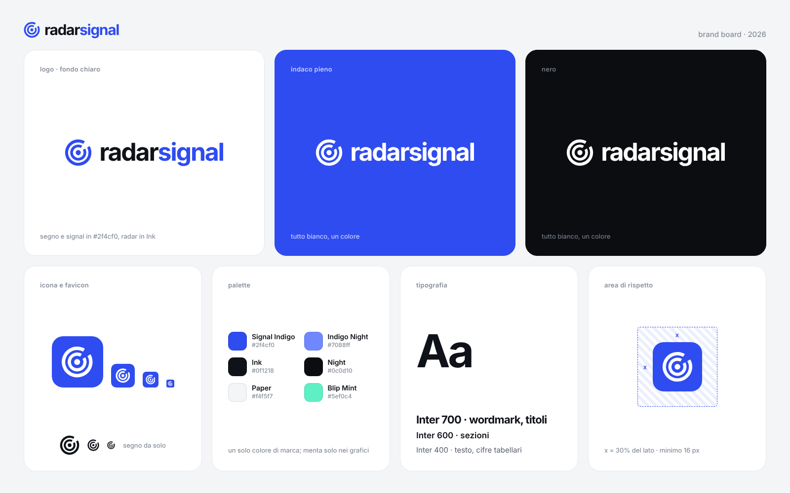

<p align="center"></p>

# Radar Signal BTC

Segnali di trading su **Bitcoin** con **una sola strategia: W3.1 settimanale**, in uso con capitale reale. Poche operazioni
grandi (2–3 l'anno, da settimane a mesi): long in **spot senza leva**, short in perp solo in trend ribassista confermato,
**perdita allo stop iniziale al massimo del 10%** della quota. Intorno alla strategia: dashboard aggiornata ogni ora, order book
multi-borsa, liquidazioni, notizie e calendario, avvisi su Telegram.

**Dashboard:** https://andreagalanti91.github.io/radar/ · **Bot Telegram:** [@CryptoRadarGalaBot](https://t.me/CryptoRadarGalaBot)

| Dal 01/01/2021 al 15/11/2026 (10.000 $, 1x, costi inclusi) | W3.1 | Tenere BTC |
|---|---|---|
| 10.000 $ diventano | **27.190 $** | 22.594 $ |
| Max drawdown giornaliero | **−9,8%** | −76,6% |
| Trade · win rate | 13 · 92% | – |
| Perdita allo stop iniziale | ≤ 10% della quota | – |

Attesa realistica: la domenica è il giorno di decisione migliore per caso; la mediana dei 7 giorni di decisione è circa 25.000 $
con drawdown fino a −19% (lezioni 94 e 105). Tre trade fanno il 59% del rendimento.

**Posizione al 22/11/2026:** short dal 16/11 a 65.286 $, esposizione 0,389 del capitale.

## Indice

- [Strategia W3.1](#strategia-w31) · [Dashboard](#dashboard) · [Automazioni e avvisi](#automazioni-e-avvisi)
- [Order book e liquidazioni](#order-book-e-liquidazioni) · [Ricerca](#ricerca) · [Come lavora Claude](#come-lavora-claude)
- [Configurazione](#configurazione) · [Uso locale](#uso-locale) · [Struttura del repository](#struttura-del-repository) · [Brand](#brand)

## Strategia W3.1

Codice: [`radar/weekly.py`](radar/weekly.py) · scheda: [`memoria/01-strategia/W3.1.md`](memoria/01-strategia/W3.1.md).
Si guarda solo la **candela settimanale** chiusa la domenica alle 00:00 UTC; si esegue il lunedì all'apertura.

| | Long | Short |
|---|---|---|
| Trend | chiusura > SMA 40 settimanale, EMA 20 in salita | chiusura < SMA 40 in calo su 4 settimane, EMA 20 in calo |
| Ingresso | chiusura > EMA 21 e flusso perp > 0; nei trend vecchi (≥ 16 settimane) MACD 8/21/5 sopra segnale e zero | chiusura < EMA 21 e flusso perp < 0 |
| Mercato | spot 1x | perp 1x |
| Uscita (la prima) | trailing 2,5 ATR settimanali a cricchetto · chiusura settimanale oltre la EMA 21 · distribuzione (funding 7 giorni alto con flusso contrario) | stesse regole, specchiate |

Dimensione: esposizione = min(1, 10% / distanza dello stop iniziale). Flusso = media degli ultimi 3 giorni disponibili di pf14z,
identico dal vivo e nel backtest.

Cosa fare con gli avvisi:
1. **Segnale settimanale**: entra lunedì all'apertura con l'importo indicato e metti lo stop iniziale.
2. **Trailing aggiornato**: sposta lo stop al nuovo livello.
3. **Uscita settimanale**: chiudi lunedì all'apertura; se il trailing viene toccato l'avviso arriva entro l'ora.
4. Registra ogni operazione con `/entrato` e `/uscito`: il registro confronta l'esecuzione con il segnale.

W3.1 non si cambia senza approvazione esplicita dell'utente ([`memoria/05-regole`](memoria/05-regole/REGOLE.md)).

## Dashboard

Pensata per il telefono (installabile dalla schermata Home), tema scuro e chiaro, prezzo live.

| Sezione | Contenuto |
|---|---|
| **Oggi** | posizione W3.1, Pre-analisi della prossima chiusura (soglie, stop, flusso, funding), grafico settimanale con EMA 21, SMA 40, S/R e liquidazioni vicine, notizie del giorno |
| **Storico** | trade di W3 con curva di equity contro BTC, registro dei trade reali, simulatore del capitale |
| **Liquidazioni** | mappa stimata delle liquidazioni, prezzi di liquidazione reali Hyperliquid, feed live |
| **Book** | heatmap dell'order book a 30 minuti su sei borse, muri etichettati, liquidazioni live, sentiment descrittivo, muri ritirati o eseguiti |
| **News** | calendario economico, riunioni FOMC e BCE, notizie classificate per impatto |

La pagina *Metodo* (regole complete e limiti) si apre dalla card della posizione. La sezione Wallet è in pausa dal 22/11/2026
(`RADAR_WALLETS=0`). Le pagine stanno in [`radar/pages/`](radar/pages/) e sono incluse da [`radar/dashboard.py`](radar/dashboard.py).

## Automazioni e avvisi

| Quando | Dove | Cosa fa |
|---|---|---|
| Ogni ora | [`daily.yml`](.github/workflows/daily.yml) → `python -m radar.cli daily` | dati, segnale W3.1, controlli di coerenza, soglie d'allarme, order book, liquidazioni, notizie, avvisi, dashboard su Pages |
| Ogni ora, catena di ~5 ore | [`liqsnap.yml`](.github/workflows/liqsnap.yml) | livelli di liquidazione on-chain e avvio affidabile di `daily.yml` (il cron di GitHub è best-effort) |
| Ogni 5 minuti | [`wallets.yml`](.github/workflows/wallets.yml) | sentinella wallet Hyperliquid (in pausa) |
| 00:00 UTC | dentro il giro orario | riepilogo giornaliero "Oggi" su Telegram |
| Lunedì 08:41 | attività pianificata di Claude, testo in [`deploy/RESOCONTO-SETTIMANALE.md`](deploy/RESOCONTO-SETTIMANALE.md) | resoconto della settimana chiusa |

Avvisi della strategia: segnale settimanale con piano in dollari, trailing aggiornato, allerta distribuzione, uscita, trailing
toccato in tempo reale. Avvisi di salute: dati fermi, buchi nei dati di W3.1, storico riscritto, decisione cambiata con i dati
definitivi ([`radar/coherence.py`](radar/coherence.py)), equity −15% dal massimo o 2 stop consecutivi ([`radar/guard.py`](radar/guard.py)).

**Comandi del bot** ([`radar/journal.py`](radar/journal.py)), accettati solo dalla chat `TELEGRAM_CHAT_ID`, risposta entro un'ora:

| Comando | Esempio | Cosa registra |
|---|---|---|
| `/entrato <prezzo> [quantità_btc] [long\|short]` | `/entrato 65286 0,3 short` | ingresso |
| `/uscito <prezzo> [motivo]` | `/uscito 60000 trailing` | uscita e risultato |
| `/exchange bybit\|okx` | `/exchange okx` | exchange usato |
| `/registro` · `/aiuto` | | ultimi trade con slippage e ritardo · elenco comandi |

## Order book e liquidazioni

- **Pagina Book (nel browser)**: Binance futures e spot, OKX, Bybit, Coinbase, Hyperliquid in WebSocket; storia dall'apertura
  della pagina. Muro = fascia con almeno 3 volte la liquidità media e il doppio delle fasce vicine; "ritirato" se scompare con il
  prezzo entro lo 0,3% senza attraversarlo (possibile spoofing), "eseguito" se il prezzo lo attraversa.
- **Registro lato server** ([`radar/orderbook.py`](radar/orderbook.py), ogni ora): muri di sei borse con l'esito al giro
  successivo (`data/book_walls.csv`) e una riga di sentiment per giro (`data/book_sentiment.csv`).
- **Sentiment** S = 0,5 · squilibrio del book entro ±1% + 0,5 · sbilancio delle liquidazioni a 30 minuti; non calcolato sotto
  250.000 $ di liquidazioni. **È descrittivo, non un segnale**: nei test non ha anticipato il prezzo a 1, 4 o 24 ore
  ([`research/book_sentiment`](research/book_sentiment/README.md), lezione 108). Prossima verifica: febbraio 2027.
- **Mappa delle liquidazioni** ([`radar/liqmap.py`](radar/liqmap.py)): STIMA da open interest; reali solo gli eventi raccolti e i
  prezzi di liquidazione dei conti Hyperliquid.

Server negli USA: Binance futures e Bybit rispondono 451/403, si usano archivio Binance, OKX, Coinbase, Kraken, Hyperliquid.

## Ricerca

Ogni idea si preregistra (PREREG committato da solo prima dei risultati), si testa dal 01/01/2021 su 10.000 $ con periodi
separati, placebo, vicini e correzione per test multipli, poi passa da una revisione critica separata.
**Indice di tutti gli studi: [`research/README.md`](research/README.md).** Diario completo e lezioni: [`RESEARCH.md`](RESEARCH.md).

Conclusione generale: dal 2021 solo il trend settimanale regge; tutto il resto è contesto. Ultimi studi (22/11/2026):

| Studio | Esito | Lezione |
|---|---|---|
| Swing brevi su S/R settimanali, stop 5–10%, TP 10–15% su BTC | 10.000 → 5.626 $; 0/405 configurazioni battono W3.1; il 70/30 peggiora W3.1 | 106 |
| Stessa strategia su 15 asset (indici, oro, argento, petrolio, azioni) | 0/15 validi, nessuno sopra il buy & hold | 107 |
| Sentiment da order book e liquidazioni | 0/14 test significativi; descrittivo | 108 |
| Ingressi e uscite a scaglioni, TP, stop, distribuzione su W3.1 | nessuna delle 14 varianti batte W3.1 | 105 |

## Come lavora Claude

- Istruzioni del progetto: [`CLAUDE.md`](CLAUDE.md). Memoria per una nuova sessione: [`memoria/`](memoria/00-inizia-qui/README.md),
  da leggere in ordine 00 → 05.
- Ogni richiesta passa dalla skill **gengar** ([`.claude/skills/gengar`](.claude/skills/gengar/SKILL.md)); i lavori lunghi tengono un
  file `STATO-<argomento>.md` nella radice per riprendere dopo un'interruzione.
- Agenti per mansione in [`.claude/agents/`](.claude/agents/), ognuno con file suoi; il commit lo fa la sessione principale.

| Agente | Ruolo |
|---|---|
| `radar-ui` | dashboard e pagine, verifica a 400 e 1280 px, tema chiaro e scuro |
| `radar-dati` | fonti dati e raccoglitori |
| `radar-ricerca` | backtest in `research/`, mai nel tool |
| `radar-review` | revisione critica (avvocato del diavolo) |
| `radar-verifica` | controllo del sito pubblicato dopo ogni deploy |
| `radar-wallet` | Hyperliquid: sentinella e balene |
| `radar-plan` · `radar-scan` · `radar-learn` · `radar-improve` | ciclo di ricerca automatico (non attivo) |

Prima di pubblicare: test che riproduce il problema, suite verde, render a 400 e 1280 px con dati reali, deploy, verifica sul sito.

## Configurazione

*Settings → Secrets and variables → Actions*. I valori dei secret non vanno mai scritti nel codice né in chat.

| Nome | Tipo | Predefinito | Uso |
|---|---|---|---|
| `TELEGRAM_BOT_TOKEN` | secret | – | token del bot |
| `TELEGRAM_CHAT_ID` | secret | – | chat che riceve gli avvisi e da cui si accettano i comandi |
| `RADAR_CAPITAL` | variabile | 50000 | capitale su cui si calcolano i piani in dollari |
| `RADAR_WEEKLY_SHARE` | variabile | 1.0 | quota del capitale dedicata a W3.1 |
| `RADAR_WALLETS` | variabile | 0 | `1` riaccende la sezione Wallet e la sentinella |
| `RADAR_V2_ALERTS` | variabile | 0 | `1` riaccende gli avvisi della vecchia strategia giornaliera v2 |

GitHub Pages: *Settings → Pages → Source: GitHub Actions*. Il sito si pubblica dal branch predefinito.

## Uso locale

```bash
pip install -r requirements.txt
python -m radar.cli daily                    # dati, segnale, avvisi, dashboard in site/
python3 -m unittest discover -s tests -q     # test (unittest, non pytest)
python -m radar.cli test-telegram            # verifica il bot
```

## Struttura del repository

```
radar/                 il tool
  cli.py               giro orario: orchestra tutti i moduli
  weekly.py            W3.1: storico, stato, avvisi, controllo orario del trailing
  preview.py           Pre-analisi della prossima chiusura
  data.py, features.py dati (archivio Binance, OKX provvisorio) e indicatori (flusso pf14z, funding, ATR)
  guard.py, coherence.py, provlog.py   soglie d'allarme, controlli di coerenza, registro provvisori/definitivi
  orderbook.py         registro dei muri e del sentiment, previsione 1h/4h
  liqmap.py, liqsnap.py, liqsources.py, liqcascade.py, liquidations.py   liquidazioni (stime e reali)
  news.py, macro.py    notizie, calendario, chiusure multi-asset
  telegram.py, journal.py, xinbox.py    messaggi, registro dei trade reali, post del trader seguito
  dashboard.py, dashboard_template.html, pages/   dashboard
  wallets.py, scout.py sentinella e balene Hyperliquid (in pausa)
  live.py, strategy.py, backtest.py, paper.py, lab.py, …   strategia v2 e banco di ricerca (spenti)
research/              studi: un cartella per studio con PREREG, script, risultati e README (indice in research/README.md)
memoria/               memoria del progetto per nuove sessioni (00 → 05)
tests/                 test unittest
data/                  dati e stato aggiornati dal giro orario (non modificare a mano)
deploy/                istruzioni operative (liqstream su VM europea, resoconto del lunedì)
brand/                 logo, icone, banner (sorgenti in brand/src)
.claude/               agenti e skill di Claude
.github/workflows/     daily.yml, liqsnap.yml, wallets.yml
RESEARCH.md            diario della ricerca, lezioni numerate, errori operativi da non ripetere
STATO-*.md             file di stato dei lavori lunghi di Claude
```

## Brand

<p></p>

Simbolo: un radar ridotto all'essenziale (anello, fascio e blip). Wordmark `radarsignal` in Geist bold. Palette: Signal Blue
`#3D5BFF`, Pulse Violet `#8B5CFF`, Blip Mint `#5EF0C4`, Night `#07080C`. Font: Geist, Geist Mono, Doto per i numeri principali.

Strumento di analisi, non consulenza finanziaria. I risultati passati non garantiscono quelli futuri.
