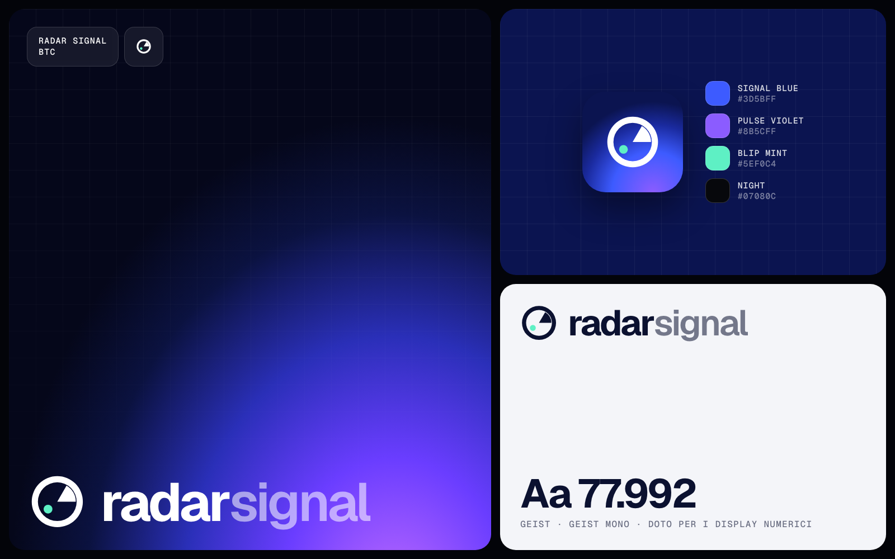

<p align="center"></p>

# Radar Signal BTC

Segnali di trading su **Bitcoin** con **una sola strategia: W2 settimanale + filtro MACD**, in uso con capitale reale dal
02/11/2026 e unica nel tool dal 05/11/2026, sul 100% di `RADAR_CAPITAL`. Poche operazioni grandi (2–3 l'anno, settimane o
mesi ciascuna): long in **spot senza leva**, short in perp solo in trend ribassista confermato, con tetto di rischio. Intorno
alla strategia: dashboard aggiornata ogni ora, mappa delle liquidazioni, order book, sentinella dei wallet Hyperliquid e
balene del giorno, tutto con alert su Telegram.

| Dal 01/01/2021 (10.000 $ a 1x, commissioni e slippage inclusi) | W2 + MACD | Tenere BTC |
|---|---|---|
| 10.000 $ diventano | **~120.000 $** | ~26.800 $ |
| Max drawdown giornaliero | **−22,7%** | −76,6% |
| Trade / win rate | 14 · 93% | – |

**Posizione aperta (al 07/11/2026):** long in spot dal 24/08/2026 a 77.812 $, trailing a 71.415 $.

**Dashboard:** https://andreagalanti91.github.io/radar/ · **Bot Telegram:** [@CryptoRadarGalaBot](https://t.me/CryptoRadarGalaBot) ·
**Repository:** https://github.com/andreagalanti91/radar

@CryptoRadarGalaBot è l'unico bot attivo: gli altri (ad esempio il Worker "whale-desk" di whalebot) per ora sono fermi, quindi
gli alert della sentinella e delle balene arrivano solo da questo repository. La strategia giornaliera v2 resta nel codice con gli
alert spenti (`RADAR_V2_ALERTS=0`); intraday e materie prime (argento, Brent) sono stati rimossi.

## Operatività reale

Si guarda solo la **candela settimanale** (chiusura UTC della domenica): la domenica sera si decide, il lunedì si esegue.

- **Trend:** long solo con chiusura sopra la SMA 40 settimanale ed EMA 20 in salita; short solo in trend ribassista (sotto la
  SMA 40 in calo, EMA 20 in calo).
- **Ingresso:** chiusura dal lato giusto della EMA 21 settimanale con flusso perp (CVD 14 giorni) concorde. **Filtro MACD:** nei
  trend vecchi (≥ 16 settimane sopra la SMA 40) un nuovo long entra solo con MACD 8/21/5 sopra il segnale e sopra zero.
- **Uscita**, alla prima di tre: trailing 2,5 ATR settimanali (controllo orario), chiusura settimanale oltre la EMA 21,
  distribuzione (funding alto con flusso perp contrario). Short in perp con stop che non costa mai più del 25% del capitale.

Cosa fare con gli alert:
1. *SEGNALE SETTIMANALE*: compra in spot l'importo indicato (lunedì all'apertura) e metti lo stop iniziale.
2. *Trailing aggiornato*: sposta lo stop al nuovo livello.
3. *USCITA SETTIMANALE*: vendi all'apertura del lunedì; se il trailing viene toccato l'alert arriva entro l'ora.
4. Registra ogni operazione con `/entrato` e `/uscito`: il registro confronta la tua esecuzione con il segnale.

Caso peggiore da ricordare: un 2018 ripetuto (top seguito da bear lungo) costerebbe circa −18% con il filtro MACD, fino a
−56/−72% senza. Con 14 trade il campione è piccolo: il registro reale è il vero giudice. Codice: `radar/weekly.py`.

## La dashboard

Pensata per il telefono (installabile dalla schermata Home), dark-first con tema chiaro, prezzo live (Binance, Coinbase di riserva).

| Sezione | Cosa trovi |
|---|---|
| **Oggi** | card della posizione con un solo prezzo di riferimento (live o ultima chiusura oraria); overlay *Perché è aperta e quando si chiude* con condizioni, uscite, piano e tutti i trade W2; grafico settimanale dal 2021 con ingressi e uscite, EMA 21, SMA 40, supporti/resistenze e cluster di liquidazione più vicini; card S/R; card *Liquidazioni vicine*; *Oggi nelle notizie* |
| **Simulatore** | capitale e data di partenza: quanto varrebbe oggi seguendo W2 + MACD (stessa equity giornaliera delle Statistiche) |
| **Statistiche** | curva di equity contro BTC, trade, risultati per anno, drawdown, registro dei trade reali |
| **Liquidazioni** | mappa stimata Binance + OKX, prezzi di liquidazione delle balene Hyperliquid, feed live, orari di aggiornamento per fonte, motore dell'order book |
| **Wallet** | sentinella in stile Hyperdash dei 3 wallet (Principale, Simile 1, Simile 2) e *Balene del giorno* con criteri e track record |
| **News** | prima il calendario economico, poi le riunioni FOMC e BCE, poi le notizie classificate per impatto |

La pagina *Metodo* (regole complete e limiti) è fuori dal menu e si apre dall'overlay della posizione. Le pagine Liquidazioni e
Wallet stanno in `radar/pages/` (`liquidazioni.html`, `wallet.html`) e vengono incluse nella dashboard da `radar/dashboard.py`.

## Automazioni e alert

| Quando | Workflow / modulo | Cosa fa |
|---|---|---|
| Ogni ora a :07 (riserva a :37) | `.github/workflows/daily.yml` → `python -m radar.cli daily` | registro Telegram, dati, segnale W2, S/R, liquidazioni, scout, order book, notizie e calendario, alert, dashboard su Pages |
| 00:30 UTC | stesso workflow | giro sulla candela giornaliera chiusa (mai saltato) |
| Ogni 5 minuti | `.github/workflows/wallets.yml` → `python -m radar.wallets` | alert sui wallet della sentinella e sulle balene del giorno |
| Una volta al giorno | `radar/scout.py` (dentro il giro orario, ≥ 20 ore dall'ultimo) | scelta delle 3 balene, verifica delle scelte passate |
| Lunedì 08:41 | resoconto su Telegram | settimana chiusa e confronto con il registro reale |

Il giro di riserva a :37 esiste perché il cron di GitHub è best-effort: si ferma subito se l'ultimo giro completo è di meno di
25 minuti fa (`data/state.json`, `last_run`). Alert della strategia (tutti "RADAR SIGNAL BTC"): segnale settimanale con piano in
dollari, trailing aggiornato, allerta distribuzione, uscita settimanale, trailing toccato in tempo reale, dati fermi da oltre 36 ore.

**Registro dei trade reali** (`radar/journal.py`, `data/journal.json`): il bot legge i comandi a ogni giro orario e risponde entro
un'ora, solo dalla chat `TELEGRAM_CHAT_ID`.

| Comando | Esempio | Cosa registra |
|---|---|---|
| `/entrato <prezzo> [quantità_btc] [long\|short]` | `/entrato 77.812 0,5` | ingresso |
| `/uscito <prezzo> [motivo]` | `/uscito 95000 trailing` | uscita e risultato |
| `/exchange bybit\|okx` | `/exchange okx` | exchange usato |
| `/registro` · `/aiuto` | | ultimi trade con slippage e ritardo medi · elenco comandi |

## Wallet e balene

**Sentinella** (`radar/wallets.py`, ogni 5 minuti): legge da Hyperliquid posizioni e ordini dei 3 wallet fissi più le 3 balene
del giorno, su tutti i DEX (principale + HIP-3), e li confronta con la fotografia precedente (cache di GitHub Actions). Alert su:
- posizione aperta, chiusa o girata;
- variazione di size di almeno il 25% **e** di almeno `RADAR_WALLET_MIN` (50.000 $);
- ordini nuovi (limit, TP, stop) da almeno `RADAR_WALLET_ORDER_MIN` (100.000 $): le "prossime mosse".

Un wallet appena entrato viene solo fotografato al primo giro, senza alert.

**Balene del giorno** (`radar/scout.py`, criteri preregistrati in `research/scout/PREREG.md`): dalla classifica e dai vault di
Hyperliquid (le stesse API pubbliche di Hyperdash) si scelgono le 3 balene con:

| Criterio | Soglia |
|---|---|
| Valore del conto | ≥ 1 M$ |
| Rendimento a 1 anno (time-weighted, depositi esclusi) | > 80% |
| Max drawdown | ≤ 30% |
| Regolarità della crescita (R²) | ≥ 0,75 |
| Funding sul PnL | ≤ 15% |

Isteresi del 15%: chi è scelto resta finché uno sfidante non lo supera del 15%. Le scelte vengono verificate a 7/30/90 giorni
contro la mediana dei candidati e dei conti ≥ 1 M$ (`data/scout_track.json`); ogni 30 giorni i pesi del punteggio si correggono
(al massimo 0,05). Quando le 3 cambiano arriva un messaggio su Telegram. Scelte in `data/wallet_picks.json`.

## Liquidazioni e order book

**Mappa delle liquidazioni** (`radar/liqmap.py`, ogni ora): STIMA da open interest Binance USDT-M + OKX, distribuito su leve
tipiche (10–100x) in fasce dello 0,25%; i livelli spariscono quando il prezzo li attraversa. Ogni fonte dichiara fin dove arriva il
dato vero e quante ore sono stimate. Hyperliquid è l'unico exchange con posizioni pubbliche: per i conti più grandi si leggono i
prezzi di liquidazione veri. Sul grafico settimanale i 2 cluster più vicini per lato. Liquidazioni reali OKX raccolte da
`radar/liquidations.py`. Ricerca (lezione 81): nessun vantaggio per W2, è contesto per le 12–24 ore successive.

**Order book** (`radar/orderbook.py`, ogni ora): fotografa Coinbase, Kraken, OKX e Binance spot; scarta le fonti con book vuoto o
incrociato, spread > 15 bps, dati vecchi o prezzo lontano dalle altre; salva la previsione a 1h/4h **prima** dell'esito e ogni
4 ore riaddestra il modello e ne misura l'accuratezza contro due riferimenti ingenui (`data/orderbook.csv`, `data/ob_model.json`).
Con pochi dati la previsione resta vicina al 50%, e la pagina lo dice.

## Ricerca

Ogni idea si preregistra (≤ 8 varianti, soglie scritte prima), si testa dal 01/01/2021 su tutti i segnali con periodi separati e
si promuove solo se migliora la famiglia di varianti, non il caso migliore. Ultime conclusioni:

| Lezione | Idea | Esito | Cartella |
|---|---|---|---|
| 74 | W2 + MACD su top 50 crypto e indici azionari | il vantaggio è solo di BTC | `research/top50/` |
| 75–77 | supporti/resistenze + volume e flusso al tocco | nessun vantaggio: S/R solo come mappa visiva | `research/sr_volume/` |
| 78 | intraday perp 1h/4h, leva 10x | rimosso dal tool | `research/intraday/` |
| 79 | MACD settimanale: flip sugli incroci, pallino verde sotto zero | scartato (instabile, sotto W2) | `research/macd_flip/` |
| 80 | strategie short dedicate (S1–S7) | scartate (sotto gli short di W2) | `research/short_w2/` |
| 81 | liquidazioni come calamita e confluenza con gli S/R | nessun vantaggio | `research/liquidazioni/` |

Diario completo, memoria dell'algoritmo e lezioni: [`RESEARCH.md`](RESEARCH.md).

## Agenti

Sotto-agenti in `.claude/agents/`, ognuno con file suoi; il commit lo fa la sessione principale dopo test e render.

| Agente | Ruolo |
|---|---|
| `radar-ui` | dashboard e pagine (`radar/dashboard_template.html`, `radar/pages/`), verifica a 400 e 1280 px, tema chiaro e scuro |
| `radar-dati` | fonti dati e raccoglitori (prezzi, perp, OI, liquidazioni, order book, Hyperliquid, notizie) |
| `radar-ricerca` | backtest delle idee in `research/`, mai nel tool |
| `radar-wallet` | Hyperliquid: pagina Wallet, sentinella, balene del giorno |
| `radar-verifica` | controllo della dashboard pubblicata, dei workflow e degli alert dopo ogni deploy |
| `radar-plan` · `radar-scan` · `radar-learn` · `radar-review` · `radar-improve` | ciclo di ricerca: piano, fotografia dei dati, prova di un'idea, avvocato del diavolo, promozione |

Giro tipo: ricerca/dati/ui in parallelo → test e render → commit → deploy → `radar-verifica`.

## Configurazione

*Settings → Secrets and variables → Actions*. I valori dei secret non vanno mai scritti nel codice.

| Nome | Tipo | Predefinito | Uso |
|---|---|---|---|
| `TELEGRAM_BOT_TOKEN` | secret | – | token del bot |
| `TELEGRAM_CHAT_ID` | secret | – | chat che riceve gli alert e da cui si accettano i comandi |
| `RADAR_CAPITAL` | variabile | 50000 | capitale su cui si calcolano i piani in dollari |
| `RADAR_WEEKLY_SHARE` | variabile | 1.0 | quota del capitale dedicata a W2 + MACD |
| `RADAR_WALLET_MIN` | variabile | 50000 | variazione minima di size per un alert wallet |
| `RADAR_WALLET_ORDER_MIN` | variabile | 100000 | valore minimo di un ordine nuovo per un alert wallet |
| `RADAR_WALLET_ALERTS` | variabile | 1 | `0` spegne gli alert dei wallet |
| `RADAR_V2_ALERTS` | variabile | 0 | `1` riaccende gli alert della strategia giornaliera v2 |

GitHub Pages: *Settings → Pages → Source: GitHub Actions*.

## Uso locale

```bash
pip install -r requirements.txt
python -m radar.cli daily            # dati, segnale, alert, dashboard in site/
python -m radar.cli test             # test
python -m radar.cli test-telegram    # verifica il bot
python -m radar.wallets              # un giro della sentinella wallet
python -m radar.scout --no-telegram  # scelta delle balene senza messaggi
```

## Struttura

```
radar/cli.py           giro orario: orchestra tutti i moduli
radar/data.py          download e cache incrementale (data/*.csv)
radar/features.py      CVD spot/perp, funding, OI, ATR, trend
radar/weekly.py        W2 + MACD: storico, stato, eventi, controllo orario del trailing
radar/levels.py        supporti e resistenze (mappa visiva)
radar/liqmap.py        mappa stimata delle liquidazioni + prezzi di liquidazione Hyperliquid
radar/liquidations.py  raccolta delle liquidazioni reali OKX
radar/orderbook.py     motore dell'order book (foto, controlli, previsione, apprendimento)
radar/wallets.py       sentinella wallet Hyperliquid (ogni 5 minuti)
radar/scout.py         balene del giorno e verifica delle scelte
radar/news.py          notizie, calendario economico, riunioni FOMC e BCE
radar/journal.py       registro dei trade reali via Telegram
radar/telegram.py      messaggi
radar/dashboard.py     dashboard (con dashboard_template.html)
radar/pages/           pagine Liquidazioni e Wallet
radar/live.py, strategy.py, backtest.py, intraday.py, paper.py, lab.py, research.py, zones.py, observe.py
                       strategia v2 e banco di ricerca (alert spenti)
research/              studi, preregistrazioni e risultati
tests/                 test (python -m radar.cli test)
brand/                 logo, icone, banner, brand board (sorgenti in brand/src)
.claude/agents/        sotto-agenti per mansione e per il ciclo di ricerca
.github/workflows/     daily.yml (orario) e wallets.yml (5 minuti)
```

Fonti dati: Binance (spot, archivio perp), OKX, Coinbase, Kraken, Hyperliquid, alternative.me, calendari ufficiali di Fed e BCE.

## Brand

<p></p>

Simbolo: un radar ridotto all'essenziale (anello, fascio e blip). Wordmark `radarsignal` in Geist bold. Palette: Signal Blue
`#3D5BFF`, Pulse Violet `#8B5CFF`, Blip Mint `#5EF0C4`, Night `#07080C`. Font: Geist, Geist Mono per etichette e chip, Doto per i
numeri principali. File in `brand/` (sorgente in `brand/src/board.html`).

Strumento di analisi, non consulenza finanziaria.
