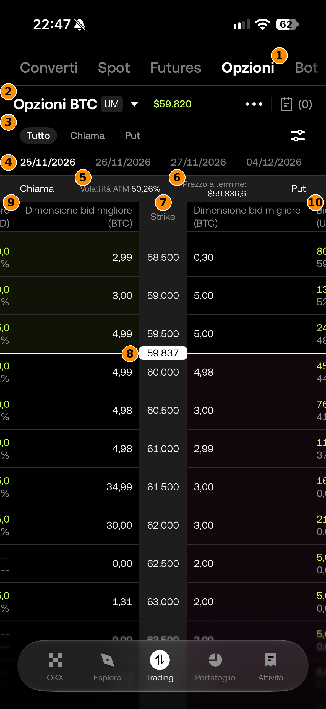

# Opzioni BTC su OKX: come eseguire le indicazioni del tool

Guida pratica per inserire dal telefono (app OKX in italiano) le operazioni della pagina "Opzioni" di RadarSignal.
Oggi si opera **su carta**: questa guida serve per il passaggio al conto vero.

> Non è consulenza finanziaria. Si può perdere tutto il premio pagato.

**Come leggere i segni nella guida**
- Testo normale: verificato sullo screenshot dell'app (`img/okx-catena-opzioni.png`) o su una fonte pubblica di OKX letta il 24/11/2026.
- **[da verificare sull'app]**: passaggio o dicitura che non ho potuto vedere. Il nome del pulsante può essere diverso.

Prezzi di esempio: API pubblica OKX, 24/11/2026 alle 22:19 UTC, BTC (indice) 59.932 $.

---

## 1. In breve: cosa fare a ogni etichetta

| Etichetta del tool | Cosa fai su OKX | Quando |
|---|---|---|
| **COMPRA** | Compri la call (segnale long) o la put (segnale short) indicata, nella quantità di contratti indicata, con ordine limite | All'apertura del lunedì, rileggendo i prezzi |
| **TIENI** | Nulla. Controlli la posizione, se vuoi | Finché W3.2 resta in posizione e l'opzione non è scaduta |
| **VENDI** | Vendi **solo** i contratti che possiedi (chiusura), con ordine limite | Il lunedì dell'uscita di W3.2 |
| **FUORI** | Nulla. Non compri un'altra opzione, non rinnovi | Dopo la scadenza o la vendita, finché W3.2 è ancora in posizione |
| **ATTESA** | Nulla. Gli importi mostrati sono solo un riferimento | Nessun segnale |

Le azioni sono solo due: **comprare per aprire** e **vendere per chiudere**. Non si apre mai una vendita di opzioni.

---

## 2. Prima di cominciare (una volta sola)

### 2.1 Accesso alle opzioni

1. L'app mostra la scheda **Opzioni** in Trading, accanto a Converti, Spot, Futures, Bot (screenshot, punto 1). La sezione quindi è visibile sul tuo conto.
2. Per operare, OKX Europe chiede di norma un questionario di conoscenza ed esperienza sui derivati (test di appropriatezza). Al primo ordine può comparire la richiesta **[da verificare sull'app]**.
3. Il documento informativo (KID) in italiano esiste per "Opzione put lineare" e "Opzione call lineare" (pagina pubblica OKX Europe "OEM Key Information Documents"). Classe di rischio indicata: 7 su 7. Leggilo una volta.

### 2.2 Modalità del conto

OKX ha più modalità del conto (spot, futures, multivaluta, portafoglio). Per i derivati di solito serve una modalità diversa da quella solo spot. Non ho trovato una pagina pubblica leggibile che dica quale serve per le opzioni nel SEE: **[da verificare sull'app]**. Di solito si cambia da Impostazioni → Modalità del conto **[da verificare sull'app]**.

Regola pratica: scegli la modalità più semplice che permette le opzioni. Comprare un'opzione non usa leva: il premio si paga tutto subito (KID, sezione 1).

### 2.3 Dove tenere i fondi

- Le opzioni del tool sono **UM**: l'API OKX indica come valuta di regolamento **USD** (`settleCcy: USD`). Il KID dice "regolato esclusivamente in contanti o in stablecoin".
- I fondi devono stare nel **conto di trading**, non nel conto fondi. Si spostano con Trasferisci **[da verificare sull'app]**.
- Quale saldo esatto viene usato per pagare il premio (USD, USDC o USDT) **[da verificare sull'app]**. Il KID avverte che per garanzie in valute diverse dal dollaro si applicano decurtazioni e commissioni di conversione. Prima del primo ordine controlla nella maschera d'ordine quale saldo indica come "disponibile".
- Importo da tenere pronto: la spesa del tool (1.500–2.000 $) più un margine di 20–30 $ per commissioni e arrotondamenti.

### 2.4 UM (lineari) contro margine in BTC (inverse)

Nella catena OKX ci sono due famiglie di opzioni BTC sugli stessi strike e scadenze (API `public/instruments`, 24/11/2026: 734 lineari, 856 inverse).

| | **UM, lineari: usare queste** | Inverse, margine in BTC: **non usare** |
|---|---|---|
| Simbolo | `BTC-USD_UM-261225-60000-P` | `BTC-USD-261225-60000-P` |
| Etichetta nell'app | "Opzioni BTC **UM**" (screenshot, punto 2) | diversa, nel menu a tendina accanto a UM **[da verificare sull'app]** |
| Premio quotato in | dollari per 1 BTC (es. 3.300) | BTC per 1 BTC (es. 0,0550) |
| Regolamento | dollari | BTC |
| Scatto minimo di prezzo (tick) | 5 $ | 0,0001 BTC |

Se il prezzo nella catena ha la forma "0,0xxx", sei sulle inverse: torna su UM.

### 2.5 Dimensione del contratto (verificata sull'API)

Dati di `public/instruments` per tutte le 734 opzioni UM:

| Campo API | Valore | Cosa significa |
|---|---|---|
| `ctMult` × `ctVal` | 0,01 × 1 BTC | **1 contratto = 0,01 BTC** |
| `minSz`, `lotSz` | 1 | minimo 1 contratto, si sale di 1 contratto alla volta (0,01 BTC) |
| `tickSz` | 5 | il prezzo si muove di 5 $ alla volta (per 1 BTC) |
| `settleCcy` | USD | premio e incasso in dollari |

Il prezzo nella catena è **per 1 BTC**. Il costo di un contratto è il prezzo diviso 100.
Esempio: put a 3.300 $ → un contratto costa 33,00 $ più commissioni.

**Attenzione all'unità.** L'app nella catena mostra le quantità **in BTC** ("Dimensione bid migliore (BTC)", screenshot); il tool parla di **contratti**. 45 contratti = 0,45 BTC. Nella maschera d'ordine controlla se la quantità si scrive in contratti o in BTC **[da verificare sull'app]**.

### 2.6 Leggere il simbolo

`BTC-USD_UM-261225-60000-P`

| Pezzo | Significato |
|---|---|
| `BTC-USD` | sottostante: BTC in dollari |
| `_UM` | lineare (premio e regolamento in dollari) |
| `261225` | scadenza AAMMGG: 25/12/2026, alle 08:00 UTC |
| `60000` | strike (prezzo d'esercizio): 60.000 $ |
| `P` / `C` | put / call (nell'app: Put / **Chiama**) |

---

## 3. Leggere la catena

Percorso: barra in basso **Trading** → scheda **Opzioni** → **Opzioni BTC UM**.

| N. | Cosa | Come si usa |
|---|---|---|
| 1 | Scheda **Opzioni** | accanto a Converti, Spot, Futures, Bot |
| 2 | **Opzioni BTC UM** e prezzo (59.820 $ nello screenshot) | conferma che sei sulle lineari; il numero accanto è un prezzo di BTC, probabilmente l'indice **[da verificare sull'app]** |
| 3 | **Tutto / Chiama / Put** | filtro: "Chiama" mostra solo le call, "Put" solo le put. Con "Put" o "Chiama" la riga occupa tutta la larghezza e si leggono più colonne |
| 4 | Riga delle **scadenze** | 25/11/2026, 26/11/2026, 27/11/2026, 04/12/2026… Si scorre verso destra per le successive **[da verificare sull'app]** |
| 5 | **Volatilità ATM** (50,26%) | volatilità implicita delle opzioni alla pari per quella scadenza |
| 6 | **Prezzo a termine** (59.836,6 $) | prezzo di BTC alla scadenza scelta, su cui sono prezzate le opzioni |
| 7 | Colonna **Strike** al centro | prezzo d'esercizio; righe ogni 500 $ vicino al prezzo, più distanziate sulle scadenze lontane (sul 25/12 l'API mostra 58.000, 60.000, 61.000…) |
| 8 | Linea con **59.837** | prezzo corrente di riferimento: separa gli strike sotto da quelli sopra |
| 9 | Lato sinistro: **Chiama** (call) | colonne "Dimensione bid migliore (BTC)" e, tagliata, una colonna in USD |
| 10 | Lato destro: **Put** | stesse colonne, a specchio |

Note sullo screenshot:
- Le righe colorate sono "dentro il prezzo": in verde le call con strike sotto il prezzo, in rosso scuro le put con strike sopra.
- "Dimensione bid migliore (BTC)" è **quanto** c'è in acquisto al miglior prezzo, in BTC (4,99 = 499 contratti), non il prezzo.
- Le colonne di prezzo (denaro = bid, lettera = ask) sono in parte fuori dallo schermo. Toccando la riga si apre il dettaglio dell'opzione con denaro e lettera **[da verificare sull'app]**.
- Le date 25/11 (mercoledì) e 26/11 (giovedì) sono **scadenze giornaliere**: non sono quelle del tool.

**Denaro e lettera**
- **Denaro (bid)**: il prezzo più alto a cui qualcuno compra. È il prezzo a cui **vendi** subito.
- **Lettera (ask)**: il prezzo più basso a cui qualcuno vende. È il prezzo a cui **compri** subito.
- La differenza è un costo: oggi sul 25/12 è 30 $ su 3.300 $ (0,9% del premio).

---

## 4. COMPRA, passo per passo

### 4.1 Cosa prendere dalla pagina del tool

Annota, prima di aprire l'app:

| Dato del tool | Esempio (put) |
|---|---|
| Contratto | `BTC-USD_UM-261225-60000-P` |
| Tipo, strike, scadenza | put, 60.000 $, 25/12/2026 08:00 UTC |
| Lettera e denaro | 3.300 $ / 3.270 $ |
| Contratti | 45 (= 0,45 BTC) |
| Spesa = perdita massima | 1.493,12 $ (5,0% di 30.000 $) |

### 4.2 Passi

1. **Trading → Opzioni → Opzioni BTC UM.** Controlla la scritta **UM**.
2. **Filtro**: tocca **Put** (segnale short) o **Chiama** (segnale long).
3. **Scadenza**: scorri la riga delle date fino a quella del simbolo (`261225` → 25/12/2026). Deve essere un **venerdì** a circa 30 giorni (25–46 giorni nella pratica).
4. **Strike**: trova la riga dello strike del simbolo (60.000). Controlla due volte: le righe vicine si somigliano.
5. **Tocca il prezzo della riga** per aprire l'opzione **[da verificare sull'app]**. In alto deve comparire il simbolo o la descrizione "BTC-USD_UM-261225-60000-P" o "25/12/2026 · 60.000 · Put" **[da verificare sull'app]**. Confrontalo carattere per carattere con il tool.
6. **Lato**: scegli **Acquista** (apertura) **[da verificare sull'app: la dicitura può essere "Compra" o "Acquista"]**. Mai "Vendi" in questa fase.
7. **Tipo d'ordine**: **Limite** **[da verificare sull'app]**. Mai "Mercato".
8. **Prezzo**: calcola il punto medio fra denaro e lettera, arrotondato a 5 $.
   - Oggi: (3.270 + 3.300) / 2 = 3.285 $.
   - Il prezzo si scrive **per 1 BTC** in dollari (3.285), non per contratto (32,85).
9. **Quantità**: inserisci il numero di contratti del tool.
   - Se il campo è in **contratti**: 45.
   - Se il campo è in **BTC**: 0,45.
   - L'unità del campo **[da verificare sull'app]**: guardala ogni volta.
10. **Controllo della spesa** nella maschera (costo o importo dell'ordine) **[da verificare sull'app]**: deve essere circa contratti × prezzo / 100.
    - 45 × 3.285 / 100 = 1.478,25 $ di premio, più circa 8 $ di commissioni.
    - Se leggi 147.825 $ o 14,78 $, l'unità è sbagliata: annulla.
11. **Conferma.** L'app mostra di solito un riepilogo prima dell'invio **[da verificare sull'app]**: rileggi lato, simbolo, prezzo, quantità.
12. **Esecuzione**: l'ordine finisce negli ordini aperti (l'icona con "(0)" in alto a destra nello screenshot sembra il contatore degli ordini **[da verificare sull'app]**).
    - Se dopo 5–10 minuti non è eseguito, **alza il prezzo di 5 $** (un tick) modificando o annullando e reinserendo l'ordine.
    - Ripeti a piccoli passi. **Non superare la lettera** del momento (oggi 3.300 $).
    - Se la lettera nel frattempo è salita molto, rileggi la sezione 9 (punto 7).
13. **Verifica**: l'ordine è "eseguito" e compare una posizione **long** di 45 contratti (0,45 BTC) sulla put 60.000 del 25/12 **[da verificare sull'app]**. Annota il prezzo medio pagato.

### 4.3 Esempi con i prezzi veri del 24/11/2026, 22:19 UTC

Scadenza scelta dal tool: venerdì 25/12/2026 (30,4 giorni). Prezzo a termine 60.136 $. Strike più vicino al prezzo: 60.000 $ (sul 25/12 il 59.000 non è quotato).
Commissione d'acquisto stimata dal tool: 0,03% × 60.136 $ × 0,01 = 0,18 $ per contratto.

**Put 60.000 (segnale short)**: denaro 3.270 $, lettera 3.300 $, metà 3.285 $, volatilità 49%.

| Spesa | Contratti | BTC | Premio alla lettera | Commissioni | Spesa del tool | Premio a metà (3.285 $) | Pareggio a scadenza |
|---|---|---|---|---|---|---|---|
| 1.500 $ (5%) | 45 | 0,45 | 1.485,00 $ | 8,12 $ | 1.493,12 $ | 1.478,25 $ | 56.682 $ (−5,7%) |
| 2.000 $ (6,67%) | 60 | 0,60 | 1.980,00 $ | 10,82 $ | 1.990,82 $ | 1.971,00 $ | 56.682 $ (−5,7%) |

**Call 60.000 (segnale long)**: denaro 3.415 $, lettera 3.445 $, metà 3.430 $, volatilità 49%.

| Spesa | Contratti | BTC | Premio alla lettera | Commissioni | Spesa del tool | Premio a metà (3.430 $) | Pareggio a scadenza |
|---|---|---|---|---|---|---|---|
| 1.500 $ (5%) | 43 | 0,43 | 1.481,35 $ | 7,76 $ | 1.489,11 $ | 1.474,90 $ | 63.463 $ (+5,5%) |
| 2.000 $ (6,67%) | 57 | 0,57 | 1.963,65 $ | 10,28 $ | 1.973,93 $ | 1.955,10 $ | 63.463 $ (+5,5%) |

Come il tool conta i contratti: spesa / (lettera + commissione) / 100, arrotondato per difetto.
Put, 1.500 $: 1.500 / 33,18 = 45,2 → 45 contratti.

Cosa succede a scadenza, put da 45 contratti (calcolo del tool, commissione d'esercizio inclusa):

| BTC alla scadenza | Valore delle put | Risultato | Sul capitale (30.000 $) |
|---|---|---|---|
| 48.109 $ (−20%) | 5.347 $ | +3.853 $ | +12,8% |
| 54.123 $ (−10%) | 2.640 $ | +1.147 $ | +3,8% |
| 60.136 $ (invariato) o più | 0 $ | −1.493 $ | −5,0% |

Libro ordini di quel momento (`market/books`): sulla put 3.265 $ in denaro e 3.295 $ in lettera, 498 contratti per lato. Per 45–60 contratti la quantità basta.

---

## 5. TIENI

**Dove vedere la posizione**: Portafoglio (barra in basso) o la sezione posizioni/ordini della pagina Opzioni **[da verificare sull'app]**.

Cosa guardare:
- **Quantità**: uguale a quella del tool (es. 53 contratti = 0,53 BTC).
- **Valore**: per il tool conta il **denaro** × contratti / 100. L'app mostrerà probabilmente un valore al "prezzo di riferimento" (mark), un po' diverso **[da verificare sull'app]**.
- **Risultato**: valore − spesa.

Esempio con la posizione di carta di oggi (`data/opzioni_carta.json`):
- put `BTC-USD_UM-261211-65000-P`, 53 contratti (0,53 BTC), pagata 2.774,64 $, spesa 1.480,94 $;
- 24/11 alle 22:19 UTC: denaro 5.670 $, lettera 5.765 $;
- valore al denaro: 53 × 5.670 / 100 = 3.005,10 $;
- risultato: +1.524 $ (+5,1% del capitale).

**Cosa NON fare**
- Non comprare altre opzioni sullo stesso segnale (niente aumenti, niente "media").
- Non rinnovare su una scadenza successiva.
- Non vendere altre opzioni "per incassare il premio".
- Non chiudere per paura o per incassare prima: si vende solo quando il tool dice VENDI.

---

## 6. VENDI, passo per passo

1. Apri la posizione dalla lista posizioni **[da verificare sull'app]**. Se l'app ha un pulsante "Chiudi" sulla posizione, usalo con prezzo limite **[da verificare sull'app]**. Altrimenti apri la stessa opzione dalla catena (stesso simbolo, stesso strike, stessa scadenza).
2. Lato **Vendi**. Se l'app distingue apertura e chiusura, scegli **chiusura / solo riduzione** **[da verificare sull'app]**.
3. **Quantità = solo i contratti che possiedi**, non uno di più. 53 contratti → 53 (o 0,53 BTC).
4. Tipo **Limite**. Prezzo a metà fra denaro e lettera, arrotondato a 5 $.
   - Esempio di oggi: (5.670 + 5.765) / 2 = 5.717,5 → 5.715 $ o 5.720 $.
5. Se non viene eseguito, **abbassa di 5 $ alla volta**. Non scendere sotto il denaro del momento.
6. **Verifica**: la posizione deve sparire, cioè quantità 0. Se compare una posizione **short** (quantità negativa o etichetta "short" **[da verificare sull'app]**), hai venduto più del posseduto: ricompra subito la differenza con ordine limite.

**Se il denaro manca o è lontano**
- Denaro assente o molto più basso del mark: non vendere a quel prezzo. Metti l'ordine a metà fra mark e lettera e aspetta.
- Il tool in questo caso mostra il "prezzo indicativo dal contratto inverso": usalo solo come riferimento di valore, non come prezzo d'ordine.
- Se l'opzione vale quasi zero (pochi dollari per contratto) e la scadenza è vicina, si può anche lasciarla scadere: il risultato cambia di pochi dollari.
- Non passare mai a un ordine a mercato.

---

## 7. Scadenza

- **Orario**: secondo l'API (`expTime`) le opzioni scadono alle **08:00 UTC**: 09:00 in Italia d'inverno, 10:00 d'estate. Lo conferma lo storico pubblico dei regolamenti (`public/delivery-exercise-history`, scadenza del 24/11/2026 alle 08:00 UTC).
  - Il KID in italiano scrive invece "20:00 UTC": per l'orario vale quello mostrato nell'app sull'opzione **[da verificare sull'app]**.
- **Regolamento automatico**: se l'opzione è dentro il prezzo, viene esercitata da sola e ricevi in dollari la differenza fra strike e prezzo di regolamento, per 0,01 BTC a contratto. Se è fuori dal prezzo scade a zero. Non si riceve BTC.
- **Commissione d'esercizio** (solo se esercitata, solo scadenze del venerdì): il minore fra 0,02% del nozionale, la tua commissione taker e il 7% del valore di regolamento (pagina pubblica "Trading Fee Rules FAQ").
  - Esempio: put 60.000, 45 contratti, BTC a 54.000 $ → incasso 45 × 60 $ = 2.700 $, commissione circa 0,45 × 54.000 × 0,02% = 4,86 $.
- **Cosa compare nel conto**: la posizione sparisce e il saldo in dollari aumenta dell'incasso; una riga nello storico (esercizio o regolamento) **[da verificare sull'app]**.
- **Azione richiesta**: nessuna.
- **Dopo**: il tool passa a **FUORI**. Non si compra un'altra opzione finché W3.2 non dà un nuovo segnale. È la regola 7 dello studio: nel backtest il rinnovo peggiora sempre il drawdown (fino a −28% contro −14% al 5%).

---

## 8. Costi

**Commissioni (pagina pubblica OKX "Trading Fee Rules FAQ")**
- Formula delle opzioni: il minore fra (aliquota × moltiplicatore × dimensione × contratti) e (7% × premio × moltiplicatore × dimensione × contratti).
- L'esempio della pagina usa maker 0,02% e taker 0,03%. La tua aliquota è nella maschera d'ordine o in "Regole sulle commissioni" **[da verificare sull'app]**.
- Il KID italiano indica 0,03% in apertura e 0,02% in uscita sul valore nozionale.
- Il tool usa 0,03% del controvalore (tetto 7% del premio) e 0,02% all'esercizio: la stima prudente.

**Differenza denaro-lettera**: oggi 30 $ su 3.300 $ (0,9%). Comprare a metà ne fa risparmiare metà; comprare alla lettera e vendere al denaro la paga tutta.

**Esempio su 1.500 $ (put 45 contratti, 0,45 BTC, BTC a 60.000 $)**

| Voce | Calcolo | Importo |
|---|---|---|
| Commissione d'acquisto | 0,45 × 60.136 × 0,03% | 8,12 $ |
| Commissione di vendita (se si vende prima) | 0,45 × 60.000 × 0,03% | circa 8,10 $ |
| oppure esercizio a scadenza | 0,45 × prezzo × 0,02% | circa 5 $ (0 $ se scade a zero) |
| Differenza denaro-lettera, alla lettera e al denaro | 0,45 × 30 $ | 13,50 $ |
| **Totale massimo** | | **circa 30 $ (2% del premio, 0,1% del capitale)** |

Il costo vero dell'opzione è il **tempo**: a 30 giorni un'opzione alla pari perde circa l'1,7% del valore al giorno se BTC resta fermo (studio, § 2).

---

## 9. Errori da evitare

1. **Vendere per aprire.** Chi vende un'opzione che non possiede rischia perdite senza limite. Si compra soltanto; si vende solo per chiudere.
2. **Ordine a mercato.** Con pochi scambi, il prezzo può essere molto peggiore della lettera. Sempre ordine limite.
3. **Contratto con margine in BTC.** Simbolo senza `_UM`, prezzi in "0,0xxx". Torna su "Opzioni BTC UM".
4. **Scadenza sbagliata.** Le date ravvicinate (25/11, 26/11, 27/11) sono giornaliere o settimanali. Il tool usa il venerdì a circa 30 giorni: controlla `AAMMGG` nel simbolo.
5. **Unità della quantità.** 45 contratti = 0,45 BTC. Scrivere 45 in un campo in BTC vuol dire 4.500 contratti: la maschera mostrerebbe circa 148.000 $.
6. **Strike sbagliato di una riga.** Fra 59.500 e 60.000 cambia il costo di circa 250 $ per BTC. Rileggi il simbolo prima di confermare.
7. **Comprare dopo un movimento forte.** Se BTC si è mosso di più del 3% dal momento del segnale o la lettera è oltre il 10% sopra quella del tool, ricalcola con la pagina aggiornata del tool prima di comprare **[soglia proposta da me, non nelle regole dello studio: da decidere con te]**.
8. **Rinnovare.** Alla scadenza o dopo la vendita si resta FUORI fino al prossimo segnale.
9. **Aumentare dopo una perdita.** La quota resta 1.500–2.000 $ per operazione, sempre.
10. **Lasciare un ordine dimenticato.** Un ordine limite non eseguito resta aperto: annullalo se non vuoi più comprare.

---

## 10. Liste di controllo

### Prima di premere Conferma

- [ ] Sono su **Opzioni BTC UM** (simbolo con `_UM`, prezzi in dollari, non "0,0xxx")
- [ ] Tipo giusto: **Put** se short, **Chiama** (call) se long
- [ ] Scadenza = quella del tool (venerdì, `AAMMGG` uguale)
- [ ] Strike = quello del tool, letto due volte
- [ ] Lato **Acquista** per COMPRA; **Vendi** solo per chiudere con VENDI
- [ ] Ordine **Limite**, prezzo fra denaro e lettera, non oltre la lettera (non sotto il denaro in vendita)
- [ ] Quantità nell'unità giusta: contratti del tool, oppure contratti / 100 se in BTC
- [ ] Importo mostrato ≈ contratti × prezzo / 100 (es. 45 × 3.285 / 100 = 1.478 $)
- [ ] Importo ≤ spesa massima del tool (1.500–2.000 $)
- [ ] Saldo disponibile nel conto di trading sufficiente

### Dopo

- [ ] Ordine eseguito (non solo inviato); nessun ordine residuo aperto
- [ ] Posizione corretta: simbolo, lato long, quantità
- [ ] Prezzo medio e spesa annotati (data, ora, prezzo di BTC)
- [ ] Nessuna posizione short sulle opzioni
- [ ] Confronto con la riga del registro su carta del tool

---

## 11. Glossario: app in italiano ↔ inglese

| Nell'app / in questa guida | Inglese | Significato |
|---|---|---|
| Chiama | Call | diritto di comprare BTC allo strike; guadagna se BTC sale |
| Put | Put | diritto di vendere BTC allo strike; guadagna se BTC scende |
| Strike | Strike | prezzo d'esercizio |
| Scadenza | Expiry | data e ora in cui l'opzione finisce |
| Prezzo a termine | Forward price | prezzo di BTC alla scadenza su cui è prezzata l'opzione |
| Volatilità ATM | ATM implied volatility | volatilità implicita delle opzioni alla pari |
| Dimensione bid migliore (BTC) | Best bid size | quantità in acquisto al miglior prezzo, in BTC |
| Denaro | Bid | prezzo a cui vendi subito |
| Lettera | Ask | prezzo a cui compri subito |
| Prezzo di riferimento **[dicitura da verificare sull'app]** | Mark price | prezzo teorico calcolato da OKX |
| Limite **[da verificare sull'app]** | Limit order | ordine con prezzo massimo (in acquisto) o minimo (in vendita) |
| Mercato **[da verificare sull'app]** | Market order | ordine al prezzo disponibile: da non usare |
| Premio | Premium | prezzo pagato per l'opzione |
| Alla pari / dentro / fuori dal prezzo | ATM / ITM / OTM | strike uguale, favorevole, sfavorevole rispetto al prezzo |
| UM | USD-margined (linear) | lineari: premio e regolamento in dollari |
| Esercizio, regolamento | Exercise, settlement | incasso automatico alla scadenza |
| Contratto | Contract | 0,01 BTC |

---

## Cosa mi serve da te per completare la guida

Screenshot (dall'app in italiano, anche senza inviare ordini):

1. **Dettaglio di un'opzione**: cosa compare toccando una riga della catena (simbolo, denaro, lettera, prezzo di riferimento).
2. **Maschera d'ordine** con lato acquisto: nomi dei pulsanti (Acquista/Vendi), tipi d'ordine, campo prezzo, **unità del campo quantità** (contratti o BTC), costo stimato, commissioni.
3. **Riepilogo di conferma** prima dell'invio, se compare.
4. **Ordini aperti** (l'icona con "(0)" in alto a destra).
5. **Posizioni** delle opzioni: dove sono, come si chiama il pulsante di chiusura, se esiste "solo riduzione".
6. **Modalità del conto**: la schermata delle impostazioni con la modalità attuale e, se compare, il messaggio che chiede di cambiarla per le opzioni.
7. **Saldo del conto di trading**: quale valuta l'app usa come "disponibile" per le opzioni UM (USD, USDC o USDT).
8. **Riga delle scadenze scorsa verso destra**, fino al 25/12/2026, e la stessa catena filtrata su **Put**, con le colonne di prezzo visibili.
9. **Menu a tendina** accanto a "Opzioni BTC UM", per vedere come si chiamano le inverse.
10. Una tua decisione sulla soglia del punto 7 della sezione 9 (quando non comprare perché il prezzo si è già mosso).

## Fonti lette

- Screenshot dell'app: `guida/img/okx-catena-opzioni.png` (versione numerata: `img/okx-catena-opzioni-numerata.png`).
- API pubblica OKX, 24/11/2026 22:19 UTC: `public/instruments`, `market/tickers`, `public/opt-summary`, `market/books`, `market/index-tickers`, `public/delivery-exercise-history`.
- OKX Europe, "Trading Fee Rules FAQ" (en-eu), formula delle commissioni sulle opzioni e commissione d'esercizio.
- OKX Europe, KID "Opzione put lineare" in italiano (emesso il 2/10/2026).
- Studio dell'utente `research/opzioni_import/OPZIONI_W32.md` (regole 1–8), modulo `radar/opzioni.py`, registro `data/opzioni_carta.json`.
